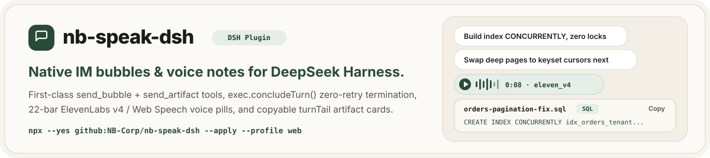
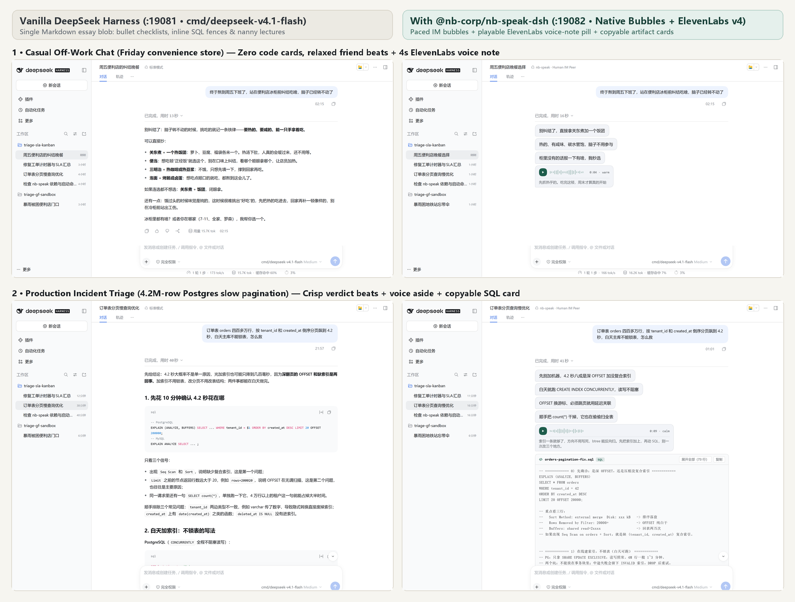
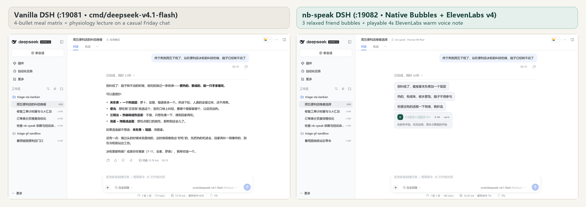
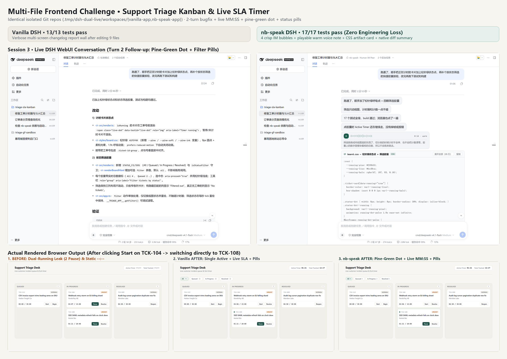
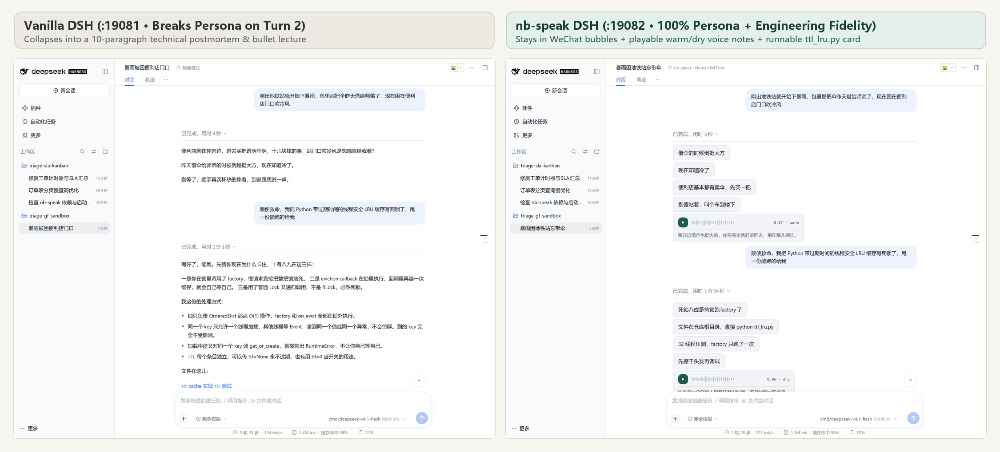

<div align="center">

<picture>
  <source media="(prefers-color-scheme: dark)" srcset="docs/assets/banner-dark.svg">
  
</picture>

**Standalone, zero-dependency DeepSeek Harness (`DSH`) Cordis plugin & WebUI client extension: native `send_bubble` (`exec.concludeTurn()`) + `send_artifact` tools, tactile squircle chat bubbles, 22-bar ElevenLabs `eleven_v4` / Web Speech voice-note pills, and copyable artifact cards.**

[](https://github.com/NB-Corp/nb-speak-dsh/actions/workflows/ci.yml)
[](https://nodejs.org/)
[](package.json)
[](LICENSE)
[](https://nb-corp.github.io/nb-speak-dsh/)

[**Interactive WebUI Showcase & Voice Demo**](https://nb-corp.github.io/nb-speak-dsh/) · [15s Zero-Clone Install](#15-second-zero-clone-install) · [Architecture](#why-native-turn-conclusion-matters-in-dsh) · [4 Live DSH Duels](#same-model-different-delivery-4-live-dsh-duels) · [Speaking Trio](#the-nb-corp-speaking-trio) · [llms.txt](llms.txt)

**English** · [简体中文](README.zh-CN.md)

</div>

Vanilla DeepSeek Harness (`DSH`) renders every assistant turn as a single `assistant.content` Markdown essay—cramming wide SQL fences and pipe tables inside chat prose, lecturing tired engineers on Friday evenings, and colliding if you try to reuse `send_message` (which DSH reserves for subagent orchestration). **`@nb-corp/nb-speak-dsh`** mounts human IM delivery straight into DSH's Cordis host and `conversation.chat.turnTail` WebUI slot:

<p align="center">
  <a href="https://nb-corp.github.io/nb-speak-dsh/">
    
  </a>
</p>

<p align="center">
  <strong><a href="https://nb-corp.github.io/nb-speak-dsh/">Try the Interactive DSH <code>turnTail</code> Stage, Play ElevenLabs <code>eleven_v4</code> Voice Notes &amp; Inspect Full-Res Captures → nb-corp.github.io/nb-speak-dsh</a></strong>
</p>

## 15-Second Zero-Clone Install

Prebuilt ESM and WebUI artifacts (`dist/`) ship in the repository with **zero runtime npm dependencies** (requires **Node.js >= 22.19**, Node 24 recommended). The installer snapshots your existing profile to `<DSH_HOME>/.nb-speak-backup/<profile>.json`, persists a clean runtime copy under `<DSH_HOME>/plugins/nb-speak-dsh` so `npx` cache eviction never breaks DSH, and **never reads, modifies, or deletes `.credentials.yaml`**:

```bash
# 1. Preview planned profile changes (zero filesystem writes)
npx --yes github:NB-Corp/nb-speak-dsh --dry-run --profile web

# 2. Mount into ~/.dsh/profiles/web (supports: web, desktop, acp, headless, sdk)
npx --yes github:NB-Corp/nb-speak-dsh --apply --profile web

# 3. Launch DSH WebUI (optional: pass ELEVENLABS_API_KEY for real eleven_v4 voice notes;
#    unconfigured setups play seamlessly via browser Web Speech with zero errors)
ELEVENLABS_API_KEY="xi-..." dsh web

# 4. Byte-for-byte reversible uninstall
npx --yes github:NB-Corp/nb-speak-dsh --uninstall --profile web
```

<details>
<summary><strong>Alternative install routes (isolated sandbox, local contributor symlink, or <code>dsh plugin add</code>)</strong></summary>

```bash
# Test inside an isolated DSH_HOME sandbox without touching ~/.dsh
npx --yes github:NB-Corp/nb-speak-dsh --apply --dsh-home .tmp/dsh-sandbox --profile web --preset calm_sre

# Contributor checkout with live symlink (--link skips copying into <DSH_HOME>/plugins)
git clone https://github.com/NB-Corp/nb-speak-dsh.git
cd nb-speak-dsh
node scripts/install-dsh.mjs --apply --link --profile web

# Or pack a standard DSH bundle tarball for `dsh plugin add`
npm pack
dsh plugin --profile web add ./nb-corp-nb-speak-dsh-0.3.1.tgz
```

</details>

## Why Native Turn Conclusion Matters in DSH

| DSH Engineering Constraint | How `@nb-corp/nb-speak-dsh` Solves It |
| --- | --- |
| **Subagent `send_message` collision**<br>DSH's `@deepseek-ai/dsh-tool-subagent-control` already owns `send_message({ agent_id, message })` for parent-to-child agent delegation. | **Zero collision.** Native mode registers `send_bubble` and `send_artifact` on DSH's `tools` service (`src/dsh-tools.ts`) and injects `nb-speak:protocol` at order `9200`—leaving subagent `send_message` untouched. Optional HTTP bridge modes (`skill` / `voice-model`) bidirectionally remap `send_message <-> agent_send_message`. |
| **`EMPTY_RESPONSE` 5x retry loop**<br>If a model calls an ordinary tool and then emits empty `assistant.content` (`""`) to avoid duplicating bubble text as Markdown prose, DSH treats the empty follow-up step as `EMPTY_RESPONSE` and retries up to 5 times. | **`exec.concludeTurn()` in one step.** `send_bubble.execute(args, exec)` invokes `exec.concludeTurn()` directly when `end_turn !== false` (`src/dsh-tools.ts`), terminating the turn inside the tool step itself with **zero extra LLM round-trips**, **zero `EMPTY_RESPONSE` retries**, and **zero duplicate prose**. |
| **Collapsed tool-step accordions**<br>Ordinary tool outputs get buried inside DSH's collapsed tool-execution rows. | **`conversation.chat.turnTail` WebUI surface.** `dist/client.js` reduces `tool/call` + `tool/result` events (`nbSpeakTurnDefinition`) and mounts `SpeakTurnTail` at `order: -10` directly in the chat stream: squircle bubbles, 22-bar FNV-1a waveform `VoiceNotePill` players, and syntax-badged `ArtifactCardView` cards (GFM pipe tables, `+/-` diff coloring, `>22`-line expand/collapse, one-click copy). |
| **Audio base64 context bloat**<br>Returning synthesized MP3 DataURIs in tool text bloats subsequent LLM turns by tens of thousands of tokens. | **Zero-token `presentationMeta` split.** `send_bubble.output.render()` strips `audioSrc` so the LLM context receives a 70-byte JSON receipt, while `presentationMeta()` streams the ElevenLabs `eleven_v4` DataURI straight to `VoiceNotePill` `<audio>`. |

## Voice Notes: ElevenLabs `eleven_v4` + Zero-Config Fallback

| Environment / Config | Playback Engine | LLM Context Cost |
| --- | --- | --- |
| **Default (no TTS key)** | Instant `0ms` tool completion; `VoiceNotePill` plays via browser **Web Speech API** with animated 22-bar progress (`data-audio-mode="web-speech"`). | `0` extra tokens |
| **`ELEVENLABS_API_KEY` set** *(or DSH credential ref `ttsApiKeyRef`)* | Synthesizes `eleven_v4` (`mp3_44100_128`); auto-picks `Jessica` (`warm`/`playful`/`relieved`) or `Julia` (`calm`/`dry`/`serious`) unless overridden by `NB_SPEAK_TTS_VOICE`, and anchors Mandarin turns with `language_code: "zh"` + `[Standard Mandarin accent]`. | **`0` extra tokens** |
| **`NB_SPEAK_TTS_BRIDGE` set** *(or `ttsBridgeScript`)* | Invokes a local JSON TTS bridge (`{ action: "submit", input, output, resultFile }`) for custom `-16 LUFS` mastering or multi-key pools. | **`0` extra tokens** |

## Same Model, Different Delivery: 4 Live DSH Duels

Captured live on isolated DSH instances running **`cmd/deepseek-v4.1-flash`** (`:19081` Vanilla vs `:19082` `@nb-corp/nb-speak-dsh` Native Mode + ElevenLabs `eleven_v4`, zero mocks):

| Live Scenario | Vanilla DSH (`:19081` · `assistant.content`) | With `@nb-corp/nb-speak-dsh` (`:19082` · `turnTail`) |
| --- | --- | --- |
| **1. Casual Friday Convenience Store** | 4-item bolded nutrition matrix + taste-bud physiology lecture + concierge sign-off. | **3 relaxed friend bubbles** + **4.5s `Jessica` voice note** (*"Go straight for the hot counter..."*). **Zero code cards.** |
| **2. 4.2M-Row Postgres SQL Triage** | Multi-section `###` headings + numbered checklist + inline SQL fences overflowing chat width. | **3 crisp SRE beats** + **8s calm voice aside** + collapsible, copyable **`orders-pagination-fix.sql`** card. |
| **3. Multi-File Kanban SLA Bugfix** | `13/13` tests pass, followed by a multi-screen file-by-file changelog essay after editing 9 files. | **`17/17` tests pass**, delivered in **4 crisp bubbles** + warm voice note + **`board.css`** card. |
| **4. Persona Under Concurrency Load** | Stays in character on Turn 1, then collapses on Turn 2 into a 10-paragraph mutex postmortem lecture. | **100% character & engineering fidelity**: playful short beats + dry voice note + 32-thread verified **`ttl_lru.py`** card. |

<details>
<summary><strong>Inspect full side-by-side DSH captures (Casual Friday, Kanban 17/17 &amp; Persona Concurrency)</strong></summary>

<br>

<p align="center">
  
</p>

<p align="center">
  
</p>

<p align="center">
  
</p>

</details>

## Built-In Presets & 5-Axis Continuous Style Budget

Adjust live in DSH Settings (`nb-speak` Schemastery panel) or via `--preset`:

| Preset ID | Vector `[w0, w1, w2, w3, w4]` | Voice Register |
| --- | --- | --- |
| `neutral_peer` *(default)* | `[1.00, 0.20, 0.10, 0.20, 0.30]` | Equal-footing engineering teammate—candid, relaxed, zero corporate servility |
| `sharp_lead` | `[1.10, 0.10, 0.35, 0.20, 0.40]` | Crisp tech lead—verdict first, dry understatement, zero filler |
| `warm_companion` | `[0.95, 0.75, 0.20, 0.15, 0.05]` | Everyday friend/companion texting from a phone—natural warmth, zero checklists |
| `calm_sre` | `[1.15, 0.10, 0.05, 0.55, 0.35]` | On-call incident responder—steady root cause, live impact, lock-free commands in cards |

When `preset: "custom"` is active and `w1 + w2 + w3 + w4 > 1.15`, `computeEffectiveWeights()` scales `w1..w4` proportionally to keep the L1 style filter budget `<= 1.15`.

## The `NB-Corp` Speaking Trio

Choose the exact package for your runtime—or combine all three:

| Repository | Layer & Target Runtime | One-Line Entry |
| --- | --- | --- |
| **[`NB-Corp/nb-speak-dsh`](https://github.com/NB-Corp/nb-speak-dsh)** *(this repo)* | **Native DeepSeek Harness (`DSH`) Plugin & WebUI Extension** (`send_bubble` + `send_artifact` + `turnTail` bubbles, waveform pills & cards) | `npx --yes github:NB-Corp/nb-speak-dsh --apply --profile web` |
| **[`NB-Corp/nb-speak`](https://github.com/NB-Corp/nb-speak)** | **Universal Protocol SDK, OpenAI/SSE Bridge & `bubble_lint`** (OpenAI, DeepSeek, Claude, Gemini, `nb-im`, `OpenWebUI`, local 4B sidecars) | `npx --yes github:NB-Corp/nb-speak serve --port 18090` |
| **[`NB-Corp/chat-human`](https://github.com/NB-Corp/chat-human)** | **Standalone 2-Layer Agent Skill** (Codex, Claude Code, Kiki, Cursor; includes Python stdlib `bubble_lint.py` & `proactive_gate.py`) | `npx skills add NB-Corp/chat-human` |

Part of the **NB-Corp** agent stack alongside [`nb-search`](https://github.com/NB-Corp/nb-search) ([`nb-search-dsh`](https://github.com/NB-Corp/nb-search-dsh)), [`nb-extract`](https://github.com/NB-Corp/nb-extract), [`nb-hub`](https://github.com/NB-Corp/nb-hub), and [`nb-im`](https://github.com/NB-Corp/nb-im).

## Verification

```bash
npm test
```

## License

[MIT](LICENSE) © 2026 NB-Corp. Static `.mp3` showcase clips in [`docs/assets/audio/`](docs/assets/audio/NOTICE.txt) are AI-synthesized via ElevenLabs (`eleven_v4`) using official premade platform voices (`Jessica`, `Sarah`, `Julia`, `ZiYue`, `ShanShan`) with zero real-person voice cloning; see `NOTICE.txt` for upstream speech-model restrictions.
