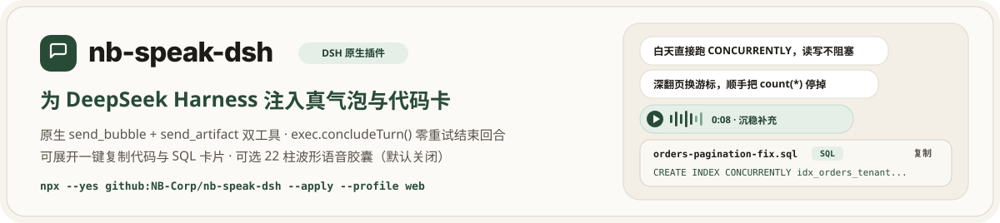
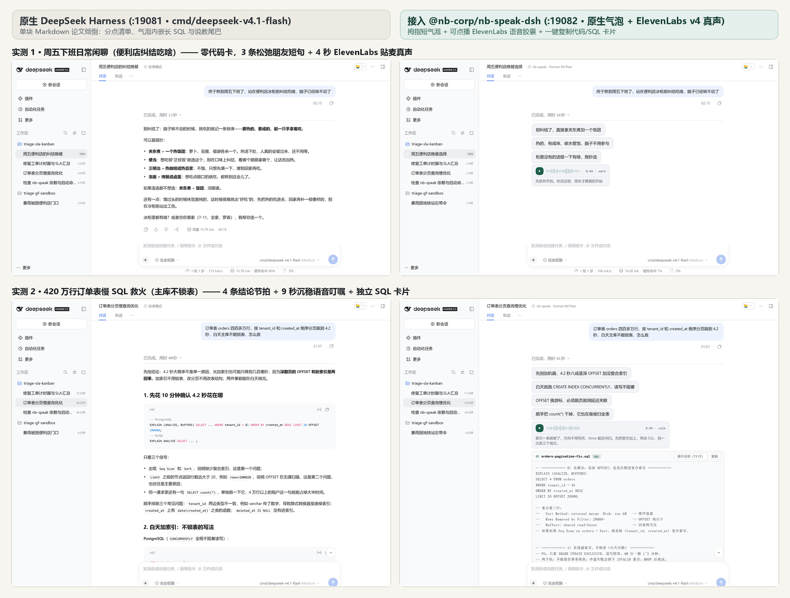
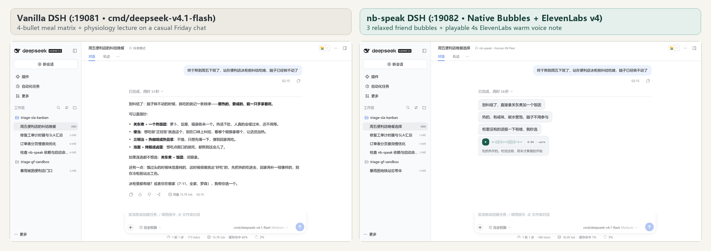
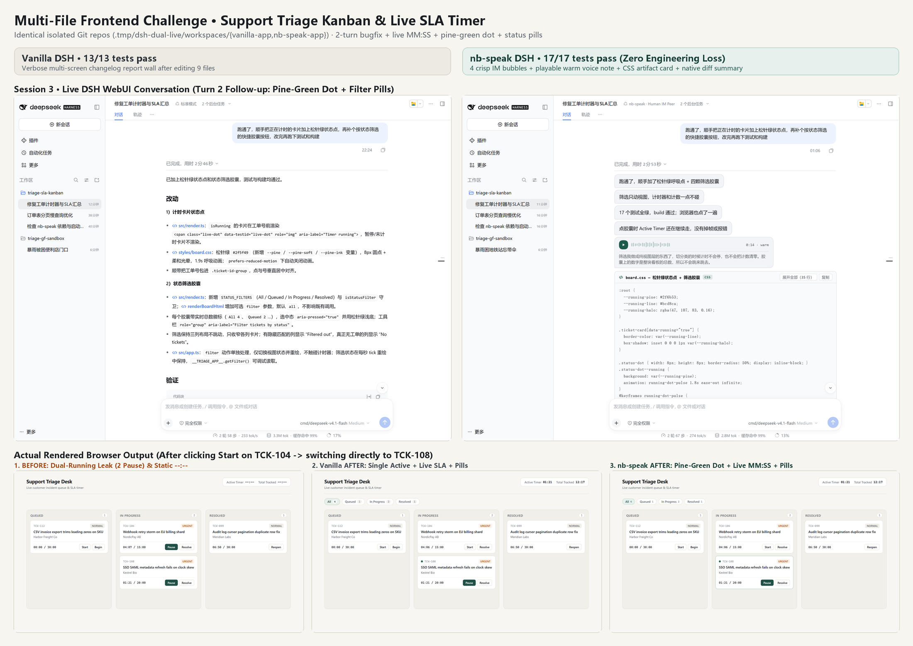
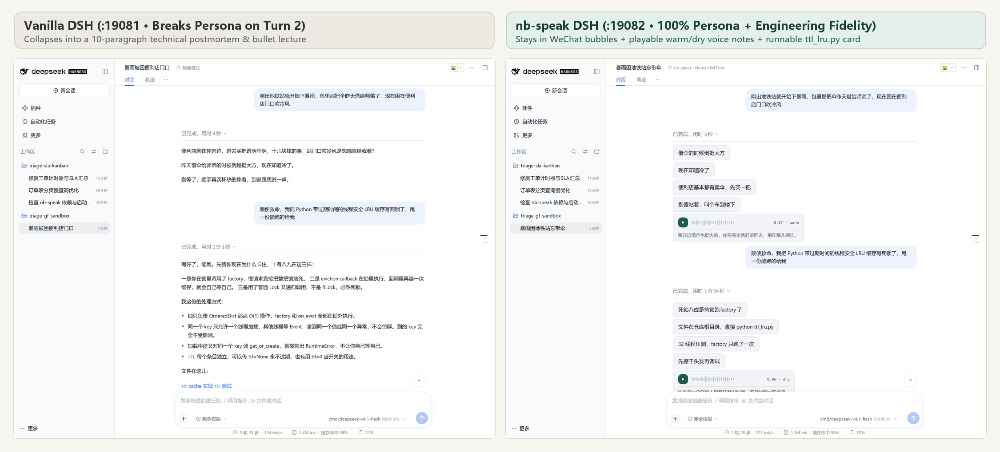

<div align="center">

<picture>
  <source media="(prefers-color-scheme: dark)" srcset="docs/assets/banner-zh-dark.svg">
  
</picture>

**独立零依赖的 DeepSeek Harness (`DSH`) 原生真气泡插件与 WebUI 扩展：一等公民 `send_bubble` (`exec.concludeTurn()`) + `send_artifact` 双工具、有机圆角聊天气泡、22 柱 ElevenLabs `eleven_v4` / Web Speech 波形语音胶囊与一键复制代码卡片。**

[](https://github.com/NB-Corp/nb-speak-dsh/actions/workflows/ci.yml)
[](https://nodejs.org/)
[](package.json)
[](LICENSE)
[](https://nb-corp.github.io/nb-speak-dsh/zh/)

[**在线 WebUI 气泡体验 & 点播真声**](https://nb-corp.github.io/nb-speak-dsh/zh/) · [15 秒零克隆安装](#15-秒零克隆一键安装) · [核心架构解密](#三大-dsh-底层痛点与原生解法) · [四大实机对决](#同一模型两种体感四大-dsh-实机同题对决) · [说话三件套分工](#nb-corp-说话三件套选型导流) · [llms.txt](llms.txt)

[English](README.md) · **简体中文**

</div>

原生 DeepSeek Harness (`DSH`) 默认将每轮回复当作单块 `assistant.content` Markdown 长文倾倒——宽表格与长 SQL 撑爆窄聊天气泡、周五下班随口闲聊甩出四点营养讲义，且一旦试图注册 `send_message` 就会撞上 DSH 内置的子代理通信工具。**`@nb-corp/nb-speak-dsh`** 直接挂载进 DSH 的 Cordis 宿主与 `conversation.chat.turnTail` WebUI 插槽，赋予任意模型真人手机聊天的分句呼吸感：

<p align="center">
  <a href="https://nb-corp.github.io/nb-speak-dsh/zh/">
    
  </a>
</p>

<p align="center">
  <strong><a href="https://nb-corp.github.io/nb-speak-dsh/zh/">点此进入在线 DSH <code>turnTail</code> 交互舞台：点播 ElevenLabs <code>eleven_v4</code> 真声并放大检视实机大图 → nb-corp.github.io/nb-speak-dsh/zh/</a></strong>
</p>

## 15 秒零克隆一键安装

仓库内置预编译 ESM 与 WebUI 产物 (`dist/`)，**零外部 npm 运行时依赖**（需 **Node.js >= 22.19**，推荐 Node 24）。安装器会先将原配置备份至 `<DSH_HOME>/.nb-speak-backup/<profile>.json`，自动把自包含插件持久化同步到 `<DSH_HOME>/plugins/nb-speak-dsh`（彻底规避临时 `npx` 缓存清理导致的断链），且**全程绝不读取、修改或删除 `.credentials.yaml`**：

```bash
# 1. 干跑预览改动（零磁盘写入）
npx --yes github:NB-Corp/nb-speak-dsh --dry-run --profile web

# 2. 一键持久化挂载到 ~/.dsh/profiles/web（支持 web / desktop / acp / headless / sdk）
npx --yes github:NB-Corp/nb-speak-dsh --apply --profile web

# 3. 启动 DSH WebUI（可选传入 ELEVENLABS_API_KEY 开启 eleven_v4 真声 <audio>；
#    未配置密钥时零报错无缝回退浏览器 Web Speech 朗读）
ELEVENLABS_API_KEY="xi-..." dsh web

# 4. 字节级无损卸载还原
npx --yes github:NB-Corp/nb-speak-dsh --uninstall --profile web
```

<details>
<summary><strong>其他安装方式（隔离沙盒验证、本地源码热链开发 <code>--link</code> 或 <code>dsh plugin add</code>）</strong></summary>

```bash
# 在独立沙盒目录验证，不碰本机 ~/.dsh
npx --yes github:NB-Corp/nb-speak-dsh --apply --dsh-home .tmp/dsh-sandbox --profile web --preset calm_sre

# 本地二次开发热链模式（--link 直接软链当前仓库，不复制到 <DSH_HOME>/plugins）
git clone https://github.com/NB-Corp/nb-speak-dsh.git
cd nb-speak-dsh
node scripts/install-dsh.mjs --apply --link --profile web

# 或打包标准 tgz 通过 DSH 官方插件命令挂载
npm pack
dsh plugin --profile web add ./nb-corp-nb-speak-dsh-0.3.1.tgz
```

</details>

## 三大 DSH 底层痛点与原生解法

| DSH 底层机制约束 | `@nb-corp/nb-speak-dsh` 工程解法 |
| --- | --- |
| **子代理 `send_message` 撞名冲突**<br>DSH 官方 `@deepseek-ai/dsh-tool-subagent-control` 已占用 `send_message({ agent_id, message })` 负责父子 Agent 通信。 | **100% 物理避让。** 原生模式直接在 DSH `tools` 服务注册 `send_bubble` 与 `send_artifact`（并在 `order: 9200` 注入 `nb-speak:protocol` 提示段），子代理 `send_message` 原封不动；可选桥接模式（`skill` / `voice-model`）通过 `src/tool-remap.ts` 双向透明重映射 `send_message <-> agent_send_message`。 |
| **`EMPTY_RESPONSE` 五次空转重试**<br>普通工具执行完毕后，若模型为了避免输出重复 Markdown 长文而返回空 `assistant.content` (`""`)，DSH 会判定为 `EMPTY_RESPONSE` 并连续重试 5 次。 | **`exec.concludeTurn()` 单步干净收束。** `send_bubble.execute(args, exec)` 在工具执行步内部直接调用 `exec.concludeTurn()`（`src/dsh-tools.ts`），当场终结本轮对话——**0 额外模型往返、0 `EMPTY_RESPONSE` 重试、0 重复正文尾巴**。 |
| **工具输出被折叠进步骤抽屉**<br>普通工具返回值默认被收起在 DSH 顶部的折叠步骤条里，无法在主聊天流直接阅读。 | **`conversation.chat.turnTail` 原生气泡层。** `dist/client.js` 注册回合级状态归约器（`nbSpeakTurnDefinition`）并挂载至 `turnTail`（`order: -10`），在折叠步骤外直接渲染圆角短气泡、22 柱 FNV-1a 确定性波形胶囊 `VoiceNotePill` 与语法徽章制品卡 `ArtifactCardView`（支持 GFM 表格转原生 HTML 表、`+/-` Diff 着色、超 22 行折叠展开与一键复制）。 |
| **Base64 音频撑爆上下文 Token**<br>若把合成好的 MP3 DataURI 直接拼进工具文本返回，后续每轮对话都会白白吞掉数万上下文 Token。 | **零 Token 损耗的 `presentationMeta` 分流。** `send_bubble.output.render()` 自动剥离 `audioSrc`，仅向大模型返回约 70 字节的投递回执；完整 ElevenLabs `eleven_v4` 音频流经 `presentationMeta()` 直供前端 `<audio>` 点播。 |

## 贴麦语音胶囊：ElevenLabs `eleven_v4` 真声 + 零配置回退

| 运行环境 / 配置项 | 语音合成与播放链路 | 大模型上下文开销 |
| --- | --- | --- |
| **默认开箱态（未配任何密钥）** | 工具 `0ms` 即时完成；`VoiceNotePill` 自动调用浏览器 **Web Speech API** 朗读并驱动 22 柱波形进度（`data-audio-mode="web-speech"`）。 | `0` 额外 Token |
| **配置 `ELEVENLABS_API_KEY`** *(或 DSH 凭据库 `ttsApiKeyRef`)* | 调用 ElevenLabs `eleven_v4` (`mp3_44100_128`)；按情绪自动匹配 `Jessica`（`warm`/`playful`/`relieved`）或 `Julia`（`calm`/`dry`/`serious`），并对中文语音自动锚定 `language_code: "zh"` + `[Standard Mandarin accent]` 消除港台腔漂移。 | **`0` 额外 Token** |
| **配置 `NB_SPEAK_TTS_BRIDGE`** *(或 `ttsBridgeScript`)* | 调用本地 JSON TTS 桥接脚本（支持自定义 `-16 LUFS` 响度标准化或多 Key 轮询池）。 | **`0` 额外 Token** |

## 同一模型、两种体感：四大 DSH 实机同题对决

以下四组对比均在隔离双实例 DSH 上由同一模型 **`cmd/deepseek-v4.1-flash`** 真实跑出（左 `:19081` 原生模式 vs 右 `:19082` `@nb-corp/nb-speak-dsh` + ElevenLabs `eleven_v4` 真声，零 Mock）：

| 实测场景 | 原生 DSH (`:19081` · 单块 `assistant.content`) | 挂载 `@nb-corp/nb-speak-dsh` (`:19082` · `turnTail`) |
| --- | --- | --- |
| **1. 周五下班便利店纠结吃啥** | 「一条铁律」+ 4 项加粗营养清单 + 味觉钝化科普 + 管家式追问。 | **3 条松弛朋友短句** + **4.5 秒 `Jessica` 贴麦真声**（*“先抓热乎的。吃完这顿，周末才算真的开始。”*），**零代码卡**。 |
| **2. 420 万行订单表慢 SQL 救火** | 多级 `###` 标题 + 编号排查清单 + 塞在气泡里的长段 SQL 围栏。 | **3 条平辈排障结论** + **8 秒沉稳语音叮嘱** + 可展开/一键复制的 **`orders-pagination-fix.sql`** 卡片。 |
| **3. 多文件工单看板修 Bug** | `13/13` 测试通过，改完 9 个文件后倾倒整屏逐文件邀功报告墙。 | **`17/17` 测试全绿**，仅发 **4 条干脆气泡** + 贴麦语音补充秒表细节 + **`board.css`** 样式卡。 |
| **4. 傲娇女友并发死锁救援** | 第 1 轮勉强维持口吻，第 2 轮一碰并发代码立刻退化为 10 段互斥锁讲义。 | **全程 100% 稳住微信短句人设与硬核交付**：嘴硬关心短句 + 冷幽默语音条 + 32 线程压测通过的 **`ttl_lru.py`** 卡片。 |

<details>
<summary><strong>点击展开：周五下班闲聊、多文件看板 (17/17 全绿) 与人设抗压完整同屏实拍图</strong></summary>

<br>

<p align="center">
  
</p>

<p align="center">
  
</p>

<p align="center">
  
</p>

</details>

## 四套内置预设与五维连续风格预算

可在 DSH 设置面板（`nb-speak` Schemastery 表单）实时拖动或通过 `--preset` 指定：

| 预设 ID | 默认向量 `[w0, w1, w2, w3, w4]` | 说话体感 |
| --- | --- | --- |
| `neutral_peer` *(默认)* | `[1.00, 0.20, 0.10, 0.20, 0.30]` | 平辈工程师搭档——坦率松弛、直给结论、零汇报腔 |
| `sharp_lead` | `[1.10, 0.10, 0.35, 0.20, 0.40]` | 干脆技术负责人——结论先行、克制冷幽默、零废话 |
| `warm_companion` | `[0.95, 0.75, 0.20, 0.15, 0.05]` | 手机那头的熟人/伴侣——自然温度与口语节奏、零清单 |
| `calm_sre` | `[1.15, 0.10, 0.05, 0.55, 0.35]` | 一线值班 SRE——稳报根因与影响面，无锁命令全部外置成卡 |

切换至 `preset: "custom"` 时，若 `w1 + w2 + w3 + w4 > 1.15`，`computeEffectiveWeights()` 会自动按比例缩放 `w1..w4`，确保 L1 风格预算始终 `<= 1.15`。

## `NB-Corp` 说话三件套选型导流

按宿主环境即插即用，也可三层组合联动：

| 独立仓库 | 职责层级与适用宿主 | 一行接入命令 |
| --- | --- | --- |
| **[`NB-Corp/nb-speak-dsh`](https://github.com/NB-Corp/nb-speak-dsh)** *(本仓)* | **DeepSeek Harness (`DSH`) 原生插件与 WebUI 扩展**（`send_bubble` + `send_artifact` + `turnTail` 真气泡、22 柱波形胶囊与代码卡片） | `npx --yes github:NB-Corp/nb-speak-dsh --apply --profile web` |
| **[`NB-Corp/nb-speak`](https://github.com/NB-Corp/nb-speak)** | **跨框架通用协议 SDK、OpenAI/SSE 桥接网关与 `bubble_lint`**（OpenAI、DeepSeek、Claude、Gemini、`nb-im`、`OpenWebUI`、本地 4B 旁路） | `npx --yes github:NB-Corp/nb-speak serve --port 18090` |
| **[`NB-Corp/chat-human`](https://github.com/NB-Corp/chat-human)** | **独立双层 Agent Skill**（Codex、Claude Code、Kiki、Cursor 通用；内置零依赖 Python `bubble_lint.py` 与 `proactive_gate.py`） | `npx skills add NB-Corp/chat-human` |

隶属 **NB-Corp** 智能体基础设施矩阵，与 [`nb-search`](https://github.com/NB-Corp/nb-search)（及配套 [`nb-search-dsh`](https://github.com/NB-Corp/nb-search-dsh)）、[`nb-extract`](https://github.com/NB-Corp/nb-extract)、[`nb-hub`](https://github.com/NB-Corp/nb-hub)、[`nb-im`](https://github.com/NB-Corp/nb-im) 协同工作。

## 本地验证

```bash
npm test
```

## 开源协议

[MIT](LICENSE) © 2026 NB-Corp。[`docs/assets/audio/`](docs/assets/audio/NOTICE.txt) 下的静态 `.mp3` 演示音频均由 ElevenLabs (`eleven_v4`) 官方预置平台音色（`Jessica`、`Sarah`、`Julia`、`ZiYue`、`ShanShan`）合成，未使用任何真人声音克隆；上游语音模型使用约束详见 `NOTICE.txt`。
